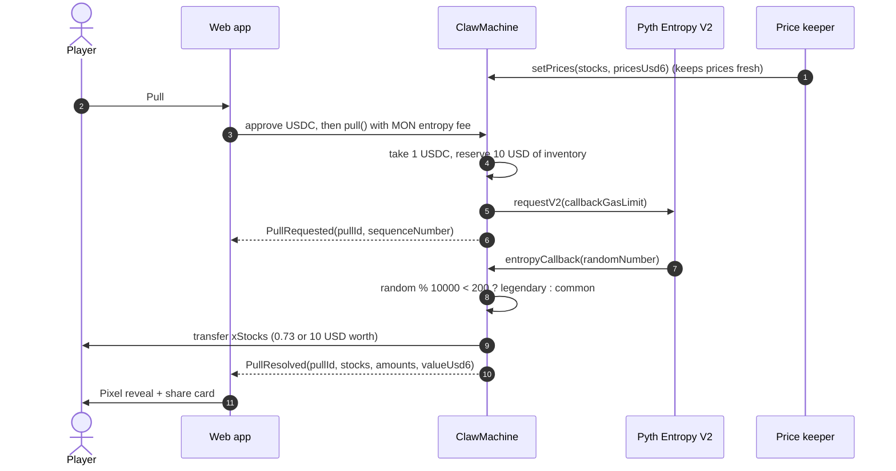

# Gacha Stocks

**A pixel-art gacha machine on Monad: pay 1 USDC, pull a card, and get real tokenized stocks (xStocks) sent straight to your wallet.**

- Live app: <LIVE_URL>
- Built at Monad Blitz, Devcon Mumbai 2026

Randomness comes from Pyth Entropy V2. The payout is transferred inside the entropy callback, so there is no claim step: the stock arrives in the same flow as the reveal animation.

| Rarity | Odds | Payout |
|---|---|---|
| Common | 98% | 0.73 USD of one xStock |
| Legendary | 2% | 10 USD of xStocks |

---

## Deployments

The app runs on **Monad testnet** (chainId 10143, required for the event) and **Monad mainnet** (chainId 143).

| Contract | Monad mainnet (143) | Monad testnet (10143) |
|---|---|---|
| ClawMachine | [`<CLAW_MACHINE_MAINNET>`](https://monadscan.com/address/<CLAW_MACHINE_MAINNET>) | [`<CLAW_MACHINE_TESTNET>`](https://testnet.monadscan.com/address/<CLAW_MACHINE_TESTNET>) |
| USDC | [`0x754704Bc059F8C67012fEd69BC8A327a5aafb603`](https://monadscan.com/address/0x754704Bc059F8C67012fEd69BC8A327a5aafb603) | MockUSDC [`<MOCK_USDC_TESTNET>`](https://testnet.monadscan.com/address/<MOCK_USDC_TESTNET>) (public `faucet()`) |
| TSLAx | [`0x8aD3c73F833d3F9A523aB01476625F269aEB7Cf0`](https://monadscan.com/address/0x8aD3c73F833d3F9A523aB01476625F269aEB7Cf0) | MockStock [`<TSLAX_TESTNET>`](https://testnet.monadscan.com/address/<TSLAX_TESTNET>) |
| NVDAx | [`0xc845b2894dBddd03858fd2D643B4eF725fE0849d`](https://monadscan.com/address/0xc845b2894dBddd03858fd2D643B4eF725fE0849d) | MockStock [`<NVDAX_TESTNET>`](https://testnet.monadscan.com/address/<NVDAX_TESTNET>) |
| SPYx | [`0x90A2a4c76b5D8c0bc892A69EA28Aa775a8f2dD48`](https://monadscan.com/address/0x90A2a4c76b5D8c0bc892A69EA28Aa775a8f2dD48) | MockStock [`<SPYX_TESTNET>`](https://testnet.monadscan.com/address/<SPYX_TESTNET>) |
| Pyth Entropy V2 | [`0xD458261E832415CFd3BAE5E416FdF3230ce6F134`](https://monadscan.com/address/0xD458261E832415CFd3BAE5E416FdF3230ce6F134) | [`0x825c0390f379C631f3Cf11A82a37D20BddF93c07`](https://testnet.monadscan.com/address/0x825c0390f379C631f3Cf11A82a37D20BddF93c07) |

xStocks use 18 decimals on-chain; USDC uses 6. Testnet has no real USDC or xStocks, so the testnet deploy script creates MockUSDC and MockStocks with the same symbols.

| | Mainnet | Testnet |
|---|---|---|
| RPC | `https://rpc.monad.xyz` | `https://testnet-rpc.monad.xyz` |
| Explorer | https://monadscan.com | https://testnet.monadscan.com |

---

## How it works



1. The player approves USDC and calls `pull()` with `msg.value >= getFee()` (the Pyth Entropy fee in MON). Excess MON is refunded.
2. `pull()` takes the pull price, reserves one legendary payout of inventory so every in-flight pull is covered, and requests a random number from Pyth Entropy V2.
3. Pyth calls back into the machine. Only the configured entropy contract can enter the callback. It picks common or legendary, chooses a random stock, converts the USD value to tokens using the keeper's on-chain prices, and transfers the tokens to the player.
4. The callback never reverts. If a token transfer fails, the amount is recorded in `owed(player, stock)` and the player retries with `withdrawOwed()`. If inventory cannot cover a payout, the shortfall is paid in USDC.
5. `canPull()` gates the button: not paused, prices fresh (`maxPriceAge`), and enough inventory for a new legendary reserve.

The web app reads history through contract views (`getRecentPulls`, `getPull`, `getPullPayout`) rather than `eth_getLogs`, which public Monad RPCs limit.

---

## Economics

- **Player EV:** 0.98 x 0.73 + 0.02 x 10 = **0.9154 USD per 1 USDC pull**.
- **House edge:** about **8.5%** per pull. That spread is the revenue model; USDC accumulates in the machine and the owner withdraws it to the treasury.
- **Inventory:** the machine holds real xStocks bought off-chain from the Kuru order books on Monad through aggregators, then transferred to the contract. Pull revenue funds the next inventory top-up.
- **Price risk:** the keeper pushes fresh xStocks prices on-chain (0.1% move or 5-minute heartbeat, with a 25% sanity guard), so payouts track the real stock value at pull time.

---

## Run it yourself

Requirements: [Foundry](https://book.getfoundry.sh/getting-started/installation) and [Bun](https://bun.sh).

### Contracts (`contracts/`)

Dependencies are vendored under `lib/`, so no install step is needed.

```bash
cd contracts
forge build
forge test        # 32 passed, 1 skipped (gated live-fork test)
```

Optional live check against the real Monad testnet Entropy contract:

```bash
FORK_TEST=true forge test --match-path test/EntropyFork.t.sol -vv
```

Deploy to Monad testnet (deploys MockUSDC, four MockStocks and ClawMachine, seeds ~500 USD of each stock, sets prices, writes `deployments/monad-testnet.json`):

```bash
cast wallet import deployer --interactive
forge script script/DeployTestnet.s.sol --rpc-url monad_testnet --account deployer --broadcast
```

Deploy to Monad mainnet (ClawMachine only, with the canonical USDC and xStocks; `KEEPER`, `TREASURY`, `STOCKS` are optional env overrides):

```bash
forge script script/DeployMainnet.s.sol --rpc-url monad --account deployer --broadcast
```

Then send xStocks to the machine address as inventory and set prices (or run the keeper). Sanity-check a testnet pull from the CLI:

```bash
cast send <MockUSDC> "faucet()" --rpc-url monad_testnet --account player
cast send <MockUSDC> "approve(address,uint256)" <ClawMachine> 1000000 --rpc-url monad_testnet --account player
FEE=$(cast call <ClawMachine> "getFee()(uint256)" --rpc-url monad_testnet | awk '{print $1}')
cast send <ClawMachine> "pull()" --value "$FEE" --rpc-url monad_testnet --account player
```

The testnet entropy fee is dynamic (about 0.128 MON for an 800k callback). Always read `getFee()` before pulling. See `contracts/README.md` for inventory, prices and admin calls.

### Web app (`web/`)

```bash
cd web
bun install
cp .env.example .env.local   # set the ClawMachine / MockUSDC addresses
bun run dev                  # http://localhost:3000
```

| Variable | Purpose |
|---|---|
| `NEXT_PUBLIC_DEFAULT_NETWORK` | `testnet` (default) or `mainnet` |
| `NEXT_PUBLIC_CLAW_MACHINE_MAINNET` | ClawMachine on Monad mainnet |
| `NEXT_PUBLIC_CLAW_MACHINE_TESTNET` | ClawMachine on Monad testnet |
| `NEXT_PUBLIC_USDC_TESTNET` | Testnet MockUSDC |
| `NEXT_PUBLIC_DEMO_MODE` | `mock` to simulate pulls with no wallet or chain |

No wallet handy? `NEXT_PUBLIC_DEMO_MODE=mock bun run dev` runs the full flow offline with the same 2% legendary odds. On testnet the wallet panel has a **Get test USDC** button (mints 100 MockUSDC) and a link to the MON faucet.

Other commands: `bun run build`, `bun run lint`, `bun run typecheck`. To host on Vercel, set the root directory to `web` and add the env vars above.

### Price keeper (`keeper/`)

```bash
cd keeper
bun install
cp .env.example .env         # NETWORK, CLAW_MACHINE_ADDRESS, KEEPER_PRIVATE_KEY
bun run dry                  # print live prices, no key, no transaction
bun run once                 # one real setPrices update, then exit
bun run start                # run forever
bun test
```

The keeper wallet must hold the keeper role (`setKeeper(address)` from the owner; the deployer is the keeper by default). Prices come from the public xStocks API, with Pyth Hermes as an optional source. Run `bun run once` right before a demo so `canPull()` is true.

---

## Tech stack

- **Contracts:** Solidity 0.8.28, Foundry, OpenZeppelin v5, Pyth Entropy V2
- **Web:** Next.js 16 (App Router), TypeScript, Tailwind CSS v4, shadcn/ui + [8bitcn](https://www.8bitcn.com) pixel components, wagmi + viem, Privy
- **Art:** pixel sprites made with claude-pxl
- **Keeper:** Bun + TypeScript + viem, xStocks price API
- **Chain:** Monad mainnet and testnet

## Repo layout

```
contracts/   Foundry project: ClawMachine, mocks, deploy scripts, tests, ABIs
web/         Next.js player app: pixel gacha machine, results feed, share cards
keeper/      Bun price keeper that pushes xStocks prices on-chain
```

## Team

- [ss251](https://github.com/ss251)
- [TheRealRajdeep](https://github.com/TheRealRajdeep)
- [AyushBherwani1998](https://github.com/AyushBherwani1998)
