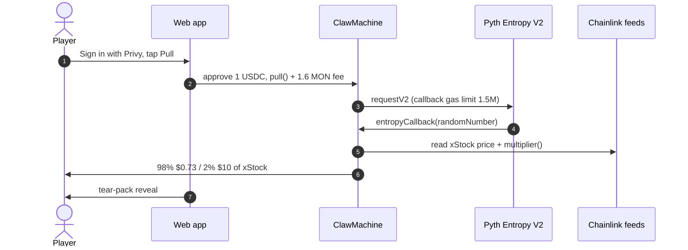

# Gachamon

**Gacha catch 'em all · Real xStocks on Monad**

Gachamon is a pixel-art pack machine on Monad mainnet. Pay 1 USDC, a Rare or Legendary pack drops, tear it open, and real tokenized stocks (xStocks) land in your wallet. Prices come from Chainlink Data Feeds on-chain, randomness from Pyth Entropy V2, and the stock is paid out inside the Entropy callback, so there is no claim step.

Built at Monad Blitz, Devcon Mumbai 2026.

## Live

| | |
|---|---|
| **App** | https://claw-web-production-312b.up.railway.app |
| **Contract** | `ClawMachine` — [`0xbC4e651C6326Ecb440b8bF54033f2ed4323C9c72`](https://monadscan.com/address/0xbC4e651C6326Ecb440b8bF54033f2ed4323C9c72) on Monad mainnet (chain 143) |
| **Source** | Verified — exact match on [Sourcify (BlockVision)](https://sourcify-api-monad.blockvision.org/v2/contract/143/0xbC4e651C6326Ecb440b8bF54033f2ed4323C9c72) |
| **Deploy tx** | [`0x2788b3f4444ea078582c127889bbeb89ab7a0024f71e5b53bcce5a5b4d89fdfc`](https://monadscan.com/tx/0x2788b3f4444ea078582c127889bbeb89ab7a0024f71e5b53bcce5a5b4d89fdfc), block 119302850 |
| **Explorers** | [Monadscan](https://monadscan.com/address/0xbC4e651C6326Ecb440b8bF54033f2ed4323C9c72) · [MonadExplorer](https://monadexplorer.com/address/0xbC4e651C6326Ecb440b8bF54033f2ed4323C9c72) |

Sign in with Privy (email or an external wallet), approve 1 USDC, and pull.

## How it works



- **Payout:** the xStock transfer happens inside the Entropy callback. No claim step.
- **Prices:** Chainlink Data Feeds on Monad, on-chain and no API key. Feeds run 24/5 with a 1 h heartbeat and 0.05% deviation. The feeds price the wrapped xStock, so the contract divides by each token's on-chain `multiplier()`. Maximum price age is 3,900 seconds.
- **Randomness:** Pyth Entropy V2 at [`0xD458261E832415CFd3BAE5E416FdF3230ce6F134`](https://monadscan.com/address/0xD458261E832415CFd3BAE5E416FdF3230ce6F134), with a 1.5M callback gas reserve. The fee is 1.6 MON per pull.
- **Revenue:** 1 USDC per pull stays in the contract.
- **Safety:** payouts never exceed what the machine holds. The owner can refund a pull stuck for more than 10 minutes.
- **Sign-in:** Privy — email or an external wallet.

| Pack | Odds | Stock payout |
|---|---|---|
| Rare | 98% | $0.73 |
| Legendary | 2% | $10 |

Expected value is **$0.9154 per $1 pull**; house edge **8.46%**.

## Stocks

Supported by the contract:

| Token | Tracks | Contract | In the machine now |
|---|---|---|---|
| TSLAx | TSLA | [`0x8aD3c73F833d3F9A523aB01476625F269aEB7Cf0`](https://monadscan.com/address/0x8aD3c73F833d3F9A523aB01476625F269aEB7Cf0) | Yes |
| NVDAx | NVDA | [`0xc845b2894dBddd03858fd2D643B4eF725fE0849d`](https://monadscan.com/address/0xc845b2894dBddd03858fd2D643B4eF725fE0849d) | Yes |
| SPYx | SPY | [`0x90A2a4c76b5D8c0bc892A69EA28Aa775a8f2dD48`](https://monadscan.com/address/0x90A2a4c76b5D8c0bc892A69EA28Aa775a8f2dD48) | Yes |
| QQQx | QQQ | [`0xa753A7395cAe905Cd615Da0B82A53E0560f250af`](https://monadscan.com/address/0xa753A7395cAe905Cd615Da0B82A53E0560f250af) | — |
| SPCXx | SpaceX | [`0x68fa48B1C2FE52b3D776E1953e0E782b5044Ce28`](https://monadscan.com/address/0x68fa48B1C2FE52b3D776E1953e0E782b5044Ce28) | — |

Currently stocked: TSLAx, NVDAx and SPYx (about $24).

## Proof: real mainnet pulls

Both pulls settled on Monad mainnet. All four transactions returned status 1.

**Pull #0 — terminal**

- Request: [`0x4029b2e8f6ec4fc3a109265ffb2a14f3a724cc91046fcf8ebd105d9693a16798`](https://monadscan.com/tx/0x4029b2e8f6ec4fc3a109265ffb2a14f3a724cc91046fcf8ebd105d9693a16798)
- Payout: [`0xc75c3aab3928f95dfaaa9b501c2db9d36090d452211b58c9cb2d4d328315d71e`](https://monadscan.com/tx/0xc75c3aab3928f95dfaaa9b501c2db9d36090d452211b58c9cb2d4d328315d71e)

**Pull #1 — browser, Privy sign-in**

- Request: [`0xb1203870e67ac85ebc8ad3b35dcc2a99f1ea5db4ef21e2330f98b8574831f3b8`](https://monadscan.com/tx/0xb1203870e67ac85ebc8ad3b35dcc2a99f1ea5db4ef21e2330f98b8574831f3b8)
- Payout: [`0x2bdf09830de939fee9a65089748a351d7cd07725d59ff5e7c3dadb1db2d5b019`](https://monadscan.com/tx/0x2bdf09830de939fee9a65089748a351d7cd07725d59ff5e7c3dadb1db2d5b019)

Verify any hash with:

```bash
cast receipt <hash> --rpc-url https://rpc.monad.xyz
```

## Run it

Requirements: [Foundry](https://book.getfoundry.sh/getting-started/installation) and [Bun](https://bun.sh).

```
contracts/   ClawMachine, mocks, deploy scripts, tests
web/         Next.js player app
backend/     optional indexer
```

### Contracts

```bash
cd contracts
forge build
forge test        # 35 tests
```

Mainnet fork tests:

```bash
MONAD_RPC=https://rpc.monad.xyz forge test --match-contract ClawMachineForkTest
```

Deploy the machine on Monad mainnet:

```bash
STOCKS=TSLAx,NVDAx,SPYx,QQQx,SPCXx \
CALLBACK_GAS_LIMIT=1500000 \
forge script script/Deploy.s.sol \
  --rpc-url https://rpc.monad.xyz \
  --broadcast \
  --private-key $KEY \
  --verify \
  --verifier sourcify \
  --verifier-url https://sourcify-api-monad.blockvision.org/
```

Testnet is not deployed — this build shipped mainnet only. `contracts/script/DeployTestnet.s.sol` deploys mocks against the real testnet Entropy at `0x825c0390f379C631f3Cf11A82a37D20BddF93c07` if you want to try the flow.

### Web

```bash
cd web
bun install
cp .env.example .env.local
```

Set these in `web/.env.local`:

```dotenv
NEXT_PUBLIC_CLAW_MACHINE_MAINNET=0xbC4e651C6326Ecb440b8bF54033f2ed4323C9c72
# Privy app id, from https://dashboard.privy.io
NEXT_PUBLIC_PRIVY_APP_ID=
NEXT_PUBLIC_SITE_URL=http://localhost:3000
NEXT_PUBLIC_DEFAULT_NETWORK=mainnet
```

Then:

```bash
bun run dev
```

Open http://localhost:3000.

`backend/` is optional: it is the indexer for indexed pull history.

## Team

- **Sailesh** ([@ss251](https://github.com/ss251)) — contracts, integration and deploy
- **Rajdeep** ([@TheRealRajdeep](https://github.com/TheRealRajdeep)) — Gachamon UI
- **Ayush** ([@AyushBherwani1998](https://github.com/AyushBherwani1998)) — contract base and backend

## Next

- Automatic inventory refill: buy $1,000 lots through xStocks issuance when stock runs low
- More stocks
- Pyth price feeds when entitled
- Ownership moved to a multisig
