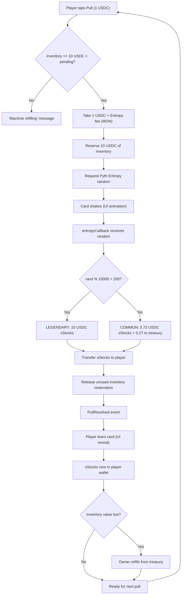
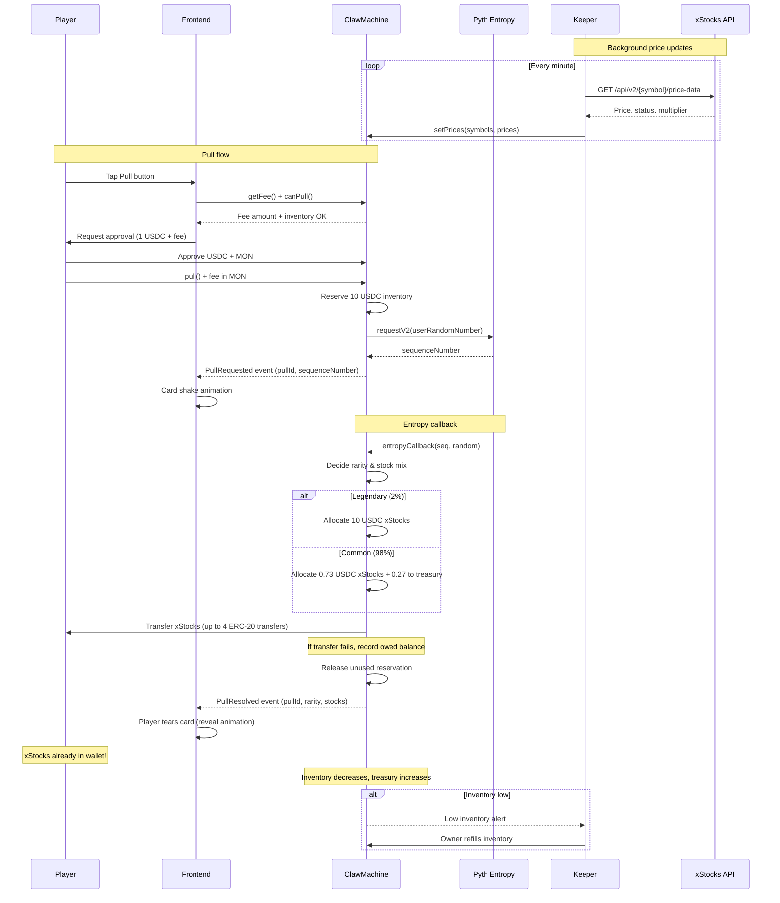

# Monad Blitz Mumbai Hackathon: xStocks Claw Machine

**Timeline:** Code freeze 5:30 PM IST, submission 5:45 PM, demos 6 PM (Nov 4, 2026)

## Overview

An xStocks "claw machine" card-pull game on Monad mainnet (chain 143). Players pay 1 USDC per pull for a chance to win xStocks (tokenized stocks: TSLA, NVDA, AAPL, SPY). Each pull has two possible outcomes:

- **Common (98%)**: Player receives 0.73 USDC worth of xStocks, 0.27 USDC goes to house treasury
- **Legendary (2%)**: Player receives 10 USDC worth of xStocks (10x payout), funded by house

Randomness is provided by Pyth Entropy on Monad mainnet.

## How It Works

1. **Player Pull**: Player pays 1 USDC + Pyth Entropy fee (in MON) to pull a card
2. **Randomness Request**: Contract requests random number from Pyth Entropy
3. **Card Shake**: UI shows card shaking animation while waiting for callback
4. **Callback Resolution**: Pyth Entropy callback determines rarity (common vs legendary) and stock mix, then **transfers xStocks directly to player's wallet**
5. **Card Reveal**: Player tears the card in UI to reveal which xStocks they received

The xStocks are transferred automatically to the player's address (the caller of `pull()`) when the Pyth Entropy callback resolves—no separate claim step or custody required.

## Economics

### Player Expected Value
- EV = (0.98 × 0.73) + (0.02 × 10) = **0.9154 USDC** per 1 USDC pull
- House edge: **~8.5%**
- Break-even legendary rate: ~2.9%

### House Costs & Inventory
- Each legendary costs house 9 USDC net (10 USDC payout minus 1 USDC received)
- 20 USDC inventory covers ~2 back-to-back legendaries
- ~27 common pulls per 20 USDC inventory
- Stock mix (TSLAx, NVDAx, AAPLx, SPYx) randomized from the same random number

### Inventory Management
- Contract holds xStocks inventory (no DEX swap—no USDC→xStocks liquidity found on Monad)
- Pulls disabled if inventory value < 10 USDC + pending reservations
- Each pull reserves 10 USDC of inventory until resolved, then releases unused portion
- Owner refills inventory with treasury USDC (off-chain purchase of xStocks, then transfer to contract)

## Architecture / Components

### Smart Contract (`ClawMachine.sol`)
- Manages USDC payments, xStocks inventory, and pull logic
- Integrates with Pyth Entropy for on-chain randomness
- Tracks pending pulls and inventory reservations
- Handles direct xStocks transfers to players in callback
- Fallback to owed balance if transfer fails (withdrawal available)

### Backend (Transaction Relay & Indexer)
- **Architecture:** Option A relay pattern
  - Frontend builds and signs the full `pull()` transaction (player pays gas + fees in MON)
  - Frontend POSTs the raw signed transaction hex to `POST /relay`
  - Backend validates (chain ID, recipient, function selector, gas limit, rate limits) and broadcasts
  - Backend never holds private keys or pays gas
- **Endpoints:**
  - `POST /relay`: Validate and broadcast signed transactions
  - `GET /machine`: Live contract reads (canPull, inventory, fees)
  - `GET /price-update`: Fetch Pyth price update data from Hermes API
  - `GET /pulls/:id`, `GET /players/:address/pulls`, `GET /leaderboard`
  - `WebSocket /events`: Real-time PullResolved events for reveal animations
- **Event Indexer:** Watches ClawMachine events via WebSocket, backfills with getLogs (1000-block chunks for Monad range limits)
- **Tech Stack:** Node 20, TypeScript, Hono, viem ≥2.40, SQLite (better-sqlite3)
- See `backend/README.md` for full API documentation and frontend integration examples

### Price Keeper (Centralized)
- Reads xStocks public API every minute: `https://api.xstocks.fi/api/v2`
  - `/{symbol}/price-data`: Current price
  - `/public/system/status/{symbol}`: Market halt status
  - `/{symbol}/multiplier`: Corporate action multipliers
- Calls `setPrices()` on contract to update xStocks valuations
- Future: Replace with Chainlink/Pyth oracle via `setOracle()` hook

### Frontend
- Card pull UI with shake/tear animations
- Wallet integration (MetaMask, etc.)
- Displays xStocks balances and pull history
- Handles USDC + MON approvals

### xStocks API
- External tokenized stock platform
- Provides real-time price data
- May have allowlist/blacklist for transfers
- Subject to market halts and corporate action multipliers

## Flow Chart



## Sequence Diagram



## Contract Interface Sketch

```solidity
// SPDX-License-Identifier: MIT
pragma solidity ^0.8.20;

interface IClawMachine {
    // Events
    event PullRequested(uint256 indexed pullId, address indexed player, uint64 sequenceNumber);
    event PullResolved(uint256 indexed pullId, address indexed player, bool legendary, address[] stocks, uint256[] amounts);
    event InventoryRefilled(address indexed owner, address[] stocks, uint256[] amounts);
    event PricesUpdated(address[] stocks, uint256[] prices, uint256 timestamp);
    
    // Structs
    struct Pull {
        address player;
        uint64 entropySequence;
        uint256 reservedValue;
        bool resolved;
    }
    
    struct StockBalance {
        address token;
        uint256 balance;
        uint256 priceUSD; // 6 decimals (USDC)
    }
    
    // Player actions
    function pull(bytes32 userRandomNumber) external payable returns (uint256 pullId);
    function withdraw() external; // Withdraw owed balance if callback transfer failed
    
    // View functions
    function canPull() external view returns (bool);
    function getFee() external view returns (uint256 entropyFeeInMON);
    function getInventoryValue() external view returns (uint256 totalValueUSD);
    function getPendingReservations() external view returns (uint256);
    function getOwedBalance(address player) external view returns (address[] memory stocks, uint256[] memory amounts);
    function getPull(uint256 pullId) external view returns (Pull memory);
    
    // Owner/keeper functions
    function setPrices(address[] calldata stocks, uint256[] calldata prices) external; // Keeper only
    function setOracle(address newOracle) external; // Owner only (future Chainlink/Pyth)
    function refillInventory(address[] calldata stocks, uint256[] calldata amounts) external; // Owner only
    function withdrawTreasury(uint256 amount) external; // Owner only
    function setKeeper(address newKeeper) external; // Owner only
    
    // Pyth Entropy callback (internal)
    function entropyCallback(uint64 sequenceNumber, address provider, bytes32 randomNumber) external;
}
```

**Key Implementation Notes:**

- `entropyCallback` must:
  - Calculate rarity: `uint256 roll = uint256(randomNumber) % 10000; bool legendary = roll < 200;`
  - Determine stock mix from same random number (e.g., `(randomNumber >> 16) % 4` for stock index)
  - Transfer xStocks directly to `pull.player` (up to 4 ERC-20 transfers)
  - If transfer fails, record owed balance in mapping; emit event with failure flag
  - Release unused inventory reservation
  - Emit `PullResolved` event
  - **Must stay within gas limit**: Monad charges by gas LIMIT, not usage. Callback limit must cover 4 cold ERC-20 transfers (10,100 gas each per Monad specs).

- Fallback for failed transfers:
  ```solidity
  mapping(address => mapping(address => uint256)) public owedBalances; // player => stock => amount
  ```

## Addresses (Monad Mainnet Chain 143)

| Asset/Contract | Address |
|----------------|---------|
| **USDC** | `0x754704Bc059F8C67012fEd69BC8A327a5aafb603` (6 decimals) |
| **Pyth Entropy** | `0xD458261E832415CFd3BAE5E416FdF3230ce6F134` |
| **Pyth Entropy Default Provider** | `0x52deaa1c84233f7bb8c8a45baede41091c616506` |
| **TSLAx** (Tesla) | `0x8ad3c73f833d3f9a523ab01476625f269aeb7cf0` |
| **AAPLx** (Apple) | `0x9d275685dc284c8eb1c79f6aba7a63dc75ec890a` |
| **NVDAx** (Nvidia) | `0xc845b2894dbddd03858fd2d643b4ef725fe0849d` |
| **SPYx** (S&P 500) | `0x90a2a4c76b5d8c0bc892a69ea28aa775a8f2dd48` |

**RPC:** `https://rpc.monad.xyz`

**Note:** Chainlink VRF is not supported on Monad, hence Pyth Entropy.

## Risks & Pre-Demo Checks

### xStocks Transfer Risks
- [ ] **Test tiny xStocks transfers to/from contract**: Possible allowlist/blacklist restrictions
- [ ] **Corporate action multipliers**: xStocks may split/reverse-split (check `/api/v2/{symbol}/multiplier`)
- [ ] **Market halts**: Trading halts would prevent transfers (check `/public/system/status/{symbol}`)
- [ ] **Decimals**: Verify each xStocks token decimals (likely 18, but confirm)

### Centralized Keeper Trust
- Single point of failure for price updates
- Could manipulate prices (though blockchain provides audit trail)
- Mitigation: Monitor keeper activity, multi-sig owner controls, plan Chainlink/Pyth migration

### Monad-Specific Considerations
- **Gas charged by LIMIT, not usage**: Set realistic gas limits; excess limit still costs gas
- **Cold storage access**: 10,100 gas per cold SLOAD/SSTORE (vs 2,100 on Ethereum)
- **Callback gas limit**: Must cover up to 4 cold ERC-20 transfers + logic (~50k+ gas recommended)
- **Foundry compatibility**: Requires Foundry ≥1.8 for Monad support
- **Viem compatibility**: Requires Viem ≥2.40 for proper Monad RPC handling

### Smart Contract Risks
- [ ] **Reentrancy**: Use OpenZeppelin's ReentrancyGuard on `pull()` and `withdraw()`
- [ ] **Entropy callback validation**: Only Pyth Entropy contract can call callback
- [ ] **Inventory underflow**: Ensure reservation logic prevents pulls when inventory insufficient
- [ ] **Integer overflow**: Use Solidity 0.8+ for automatic overflow checks
- [ ] **Owner privilege**: Use multi-sig for owner actions (refill, withdraw treasury)

### Pre-Demo Checklist
- [ ] Deploy contracts to Monad mainnet
- [ ] Transfer initial 20 USDC worth of xStocks to contract
- [ ] Deploy price keeper and verify it updates every minute
- [ ] Test one common pull end-to-end
- [ ] Test legendary pull (may need to mock or use testnet)
- [ ] Verify xStocks transfer to player wallet
- [ ] Test "machine refilling" message when inventory low
- [ ] Verify card animations (shake → tear → reveal)
- [ ] Check USDC balance increase in treasury after common pulls
- [ ] Monitor Monad block explorer for events

## Future Work

### Decentralization
- **Chainlink/Pyth Price Feeds**: Replace centralized keeper with on-chain oracles (contract already has `setOracle()` hook)
- **Multi-sig treasury**: Distribute owner privileges to prevent single point of control

### Liquidity & Swaps
- **DEX integration**: Once USDC↔xStocks liquidity exists on Monad, enable instant swaps instead of manual inventory refills
- **Automated market making**: Contract could LP on DEX to ensure liquidity for payouts

### Privacy
- **Monad Private Settlement**: Integrate for private pulls and payouts (hide player addresses and outcomes on-chain)

### Gameplay Enhancements
- **More rarities**: Add Epic (5%, 3x), Ultra (1%, 20x), etc.
- **Pack system**: Multi-card packs with guaranteed minimum rarity
- **Streak bonuses**: Increase odds after N consecutive common pulls
- **Leaderboard**: Track biggest wins, total volume per player

### Risk Mitigation
- **xStocks oracle**: Monitor multipliers/halts on-chain to auto-pause pulls during market events
- **Dynamic pricing**: Adjust house edge based on inventory levels
- **Insurance fund**: Separate reserve for covering extreme legendary streaks

### Technical Improvements
- **Layer 2 aggregation**: Batch multiple pulls to save on Monad gas
- **Callback gas optimization**: Minimize storage writes in `entropyCallback`
- **Frontend caching**: Cache xStocks prices locally, update from keeper events

---

**Good luck at Monad Blitz Mumbai! 🚀**
