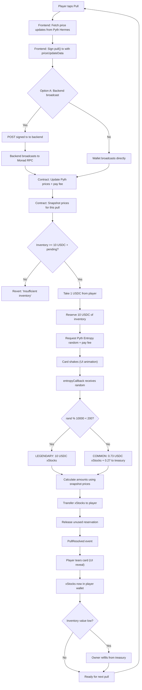
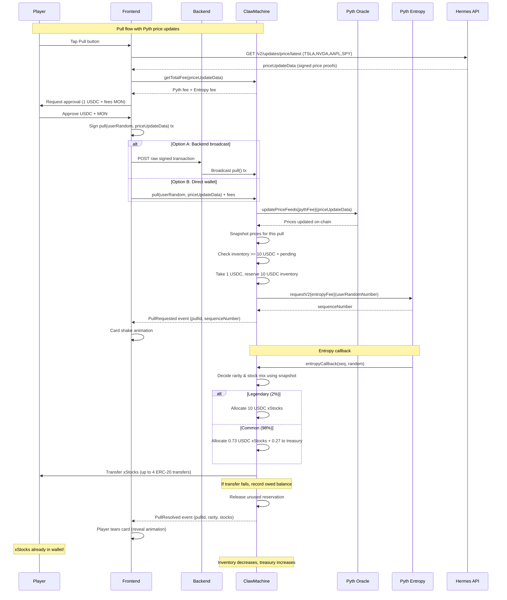

# Monad Blitz Mumbai Hackathon: xStocks Claw Machine

**Timeline:** Code freeze 5:30 PM IST, submission 5:45 PM, demos 6 PM (Nov 4, 2026)

## Overview

An xStocks "claw machine" card-pull game on Monad mainnet (chain 143). Players pay 1 USDC per pull for a chance to win xStocks (tokenized stocks: TSLA, NVDA, AAPL, SPY). Each pull has two possible outcomes:

- **Common (98%)**: Player receives 0.73 USDC worth of xStocks, 0.27 USDC goes to house treasury
- **Legendary (2%)**: Player receives 10 USDC worth of xStocks (10x payout), funded by house

Randomness is provided by Pyth Entropy on Monad mainnet.

## How It Works

1. **Fetch Prices**: Frontend fetches latest Pyth price updates from Hermes API (`https://hermes.pyth.network/v2/updates/price/latest`)
2. **Player Pull**: Player pays 1 USDC + Pyth price update fee + Pyth Entropy fee (in MON) to pull a card
3. **Update Prices**: Contract calls Pyth oracle to update on-chain prices and snapshots them for this pull
4. **Randomness Request**: Contract requests random number from Pyth Entropy
5. **Card Shake**: UI shows card shaking animation while waiting for callback
6. **Callback Resolution**: Pyth Entropy callback determines rarity (common vs legendary) and stock mix using snapshotted prices, then **transfers xStocks directly to player's wallet**
7. **Card Reveal**: Player tears the card in UI to reveal which xStocks they received

The xStocks are transferred automatically to the player's address (the caller of `pull()`) when the Pyth Entropy callback resolves—no separate claim step or custody required. Prices are snapshotted at pull request time to ensure consistent pricing even if callback is delayed.

## Economics

### Player Expected Value
- EV = (0.98 × 0.73) + (0.02 × 10) = **0.9154 USDC** per 1 USDC pull
- House edge: **~8.5%**
- Break-even legendary rate: ~2.9%

### House Costs & Inventory
- Each legendary costs house 9 USDC net (10 USDC payout minus 1 USDC received)
- 20 USDC inventory covers ~2 back-to-back legendaries
- ~27 common pulls per 20 USDC inventory
- Stock mix (TSLAx, NVDAx, AAPLx, SPYx) randomized from the same random number

### Inventory Management
- Contract holds xStocks inventory (no DEX swap—no USDC→xStocks liquidity found on Monad)
- Pulls disabled if inventory value < 10 USDC + pending reservations
- Each pull reserves 10 USDC of inventory until resolved, then releases unused portion
- Owner refills inventory with treasury USDC (off-chain purchase of xStocks, then transfer to contract)

## Architecture / Components

### Smart Contract (`ClawMachine.sol`)
- Manages USDC payments, xStocks inventory, and pull logic
- Integrates with **Pyth Price Feeds** (pull oracle) for real-time equity prices
- Integrates with Pyth Entropy for on-chain randomness
- Snapshots prices at pull request time for consistent callback execution
- Tracks pending pulls and inventory reservations
- Handles direct xStocks transfers to players in callback
- Fallback to owed balance if transfer fails (withdrawal available)

### Pyth Price Feeds (Pull Oracle)
- **Contract**: `0xACeA761c27A909d4D3895128EBe6370FDE2dF481` (PythPro on Monad)
- Frontend fetches price updates from **Pyth Hermes API**: `https://hermes.pyth.network/v2/updates/price/latest`
- Price updates include cryptographic proof of real equity prices
- Equity feed IDs:
  - **TSLA**: `0x16dad506d7db8da01c87581c87ca897a012a153557d4d578c3b9c9e1bc0632f1`
  - **NVDA**: `0xb1073854ed24cbc755dc527418f52b7d271f6cc967bbf8d8129112b18860a593`
  - **AAPL**: `0x49f6b65cb1de6b10eaf75e7c03ca029c306d0357e91b5311b175084a5ad55688`
  - **SPY**: `0x19e09bb805456ada3979a7d1cbb4b6d63babc3a0f8e8a9509f68afa5c4c11cd5`
- **Market Hours Note**: Equity feeds may be stale when US markets are closed (after 4 PM ET). Contract enforces max price age (default 60s, configurable to larger value like 5-10 minutes for after-hours trading). Pull reverts if price is too stale.

### Frontend
- Card pull UI with shake/tear animations
- Wallet integration (MetaMask, etc.)
- **Fetches Pyth price updates** from Hermes API before each pull
- Displays xStocks balances and pull history
- Handles USDC + MON approvals for pull fees (Pyth update + Entropy)
- **Transaction Flow (Option A - Recommended)**:
  1. Frontend signs the `pull()` transaction with price update data
  2. Frontend POSTs the raw signed transaction to backend
  3. Backend broadcasts transaction to Monad RPC
  4. (Alternative: Frontend broadcasts directly via wallet)

### xStocks Tokens
- External tokenized stock platform on Monad
- May have allowlist/blacklist for transfers (test before demo)
- Subject to market halts and corporate action multipliers
- Prices tracked via Pyth oracle feeds

## Flow Chart



## Sequence Diagram



## Contract Interface Sketch

```solidity
// SPDX-License-Identifier: MIT
pragma solidity ^0.8.20;

interface IClawMachine {
    // Events
    event PullRequested(uint256 indexed pullId, address indexed player, uint64 sequenceNumber, uint256 pullPrice);
    event PullResolved(uint256 indexed pullId, address indexed player, bool legendary, address[] stocks, uint256[] amounts);
    event TransferOwed(uint256 indexed pullId, address indexed player, address indexed token, uint256 amount);
    event InventoryRefilled(address[] stocks, uint256[] amounts);
    event TokenAdded(address indexed token, bytes32 feedId);
    event MaxPriceAgeUpdated(uint256 oldMaxAge, uint256 newMaxAge);
    
    // Structs
    struct TokenInfo {
        bytes32 pythFeedId;
        uint8 decimals;
        bool supported;
    }
    
    // Player actions
    function pull(bytes32 userRandomNumber, bytes[] calldata priceUpdateData) external payable returns (uint256 pullId);
    function withdrawOwed() external; // Withdraw owed balance if callback transfer failed
    
    // View functions
    function canPull() external view returns (bool);
    function getPythFee(bytes[] calldata priceUpdateData) external view returns (uint256);
    function getEntropyFee() external view returns (uint256);
    function getTotalFee(bytes[] calldata priceUpdateData) external view returns (uint256);
    function getInventoryValue() external view returns (uint256 totalValueUSDC);
    function getPendingReservations() external view returns (uint256);
    function getOwedBalance(address player) external view returns (address[] memory stocks, uint256[] memory amounts);
    function getPullBasicData(uint256 pullId) external view returns (address player, uint64 entropySequence, uint256 reservedValue, bool resolved);
    function getPullPriceSnapshot(uint256 pullId, address token) external view returns (uint256);
    
    // Owner functions (no keeper needed - Pyth provides prices)
    function addToken(address token, bytes32 pythFeedId) external; // Owner only
    function removeToken(address token) external; // Owner only
    function setParameters(uint256 _pullPrice, uint16 _commonBps, uint16 _legendaryRarityBps, uint16 _legendaryMultiplier) external; // Owner only
    function setMaxPriceAge(uint256 newMaxAge) external; // Owner only (e.g., 5-10 min for after-hours trading)
    function refillInventory(address[] calldata stocks, uint256[] calldata amounts) external; // Owner only
    function withdrawTreasury(uint256 amount) external; // Owner only
    function pause() external; // Owner only
    function unpause() external; // Owner only
    
    // Pyth Entropy callback (internal)
    function entropyCallback(uint64 sequenceNumber, address provider, bytes32 randomNumber) external;
}
```

**Key Implementation Notes:**

- `pull()` now takes `priceUpdateData` from Pyth Hermes API:
  - Frontend fetches from `https://hermes.pyth.network/v2/updates/price/latest`
  - Contract calls `pyth.updatePriceFeeds{pythFee}(priceUpdateData)` to update on-chain prices
  - Snapshots prices using `pyth.getPriceNoOlderThan(feedId, maxPriceAge)` for each token
  - Stores snapshot in `Pull` storage for use in callback (keeps callback gas low)
  - Requires `msg.value >= pythFee + entropyFee`
  - Refunds excess MON

- `entropyCallback` must:
  - Calculate rarity: `uint256 roll = uint256(randomNumber) % 10000; bool legendary = roll < 200;`
  - Determine stock mix from same random number
  - **Use snapshotted prices** from pull request time (NOT fresh prices - keeps callback cheap)
  - Transfer xStocks directly to `pull.player` (up to 4 ERC-20 transfers)
  - If transfer fails, record owed balance in `owedBalances` mapping; emit `TransferOwed` event
  - Release unused inventory reservation
  - Emit `PullResolved` event
  - **Must stay within gas limit**: Monad charges by gas LIMIT, not usage. Callback limit must cover 4 cold ERC-20 transfers (10,100 gas each per Monad specs). **Recommended: 100,000+ gas.**

- Price snapshots ensure consistent pricing even if callback is delayed or market moves

- Fallback for failed transfers:
  ```solidity
  mapping(address => mapping(address => uint256)) public owedBalances; // player => stock => amount
  ```

- **Market Hours**: Equity feeds may be stale when US markets are closed (after 4 PM ET). Contract uses `maxPriceAge` (default 60s) to reject stale prices. Can be increased to 5-10 minutes for after-hours / weekend trading.

## Addresses (Monad Mainnet Chain 143)

| Asset/Contract | Address |
|----------------|---------|
| **USDC** | `0x754704Bc059F8C67012fEd69BC8A327a5aafb603` (6 decimals) |
| **Pyth Price Feed (PythPro)** | `0xACeA761c27A909d4D3895128EBe6370FDE2dF481` (pull oracle) |
| **Pyth Entropy** | `0xD458261E832415CFd3BAE5E416FdF3230ce6F134` |
| **Pyth Entropy Default Provider** | `0x52DeaA1c84233F7bb8C8A45baeDE41091c616506` |
| **TSLAx** (Tesla) | `0x8aD3c73F833d3F9A523aB01476625F269aEB7Cf0` |
| **AAPLx** (Apple) | `0x9d275685dC284C8eB1C79f6ABA7a63Dc75ec890a` |
| **NVDAx** (Nvidia) | `0xc845b2894dBddd03858fd2D643B4eF725fE0849d` |
| **SPYx** (S&P 500) | `0x90A2a4c76b5D8c0bc892A69EA28Aa775a8f2dD48` |

### Pyth Price Feed IDs

| Symbol | Feed ID |
|--------|---------|
| **TSLA** | `0x16dad506d7db8da01c87581c87ca897a012a153557d4d578c3b9c9e1bc0632f1` |
| **NVDA** | `0xb1073854ed24cbc755dc527418f52b7d271f6cc967bbf8d8129112b18860a593` |
| **AAPL** | `0x49f6b65cb1de6b10eaf75e7c03ca029c306d0357e91b5311b175084a5ad55688` |
| **SPY** | `0x19e09bb805456ada3979a7d1cbb4b6d63babc3a0f8e8a9509f68afa5c4c11cd5` |

**Pyth Hermes API:** `https://hermes.pyth.network/v2/updates/price/latest`

**RPC:** `https://rpc.monad.xyz`

**Note:** Chainlink VRF is not supported on Monad, hence Pyth Entropy. Prices are pulled from Pyth oracle on-chain via frontend-fetched updates.

## Risks & Pre-Demo Checks

### xStocks Transfer Risks
- [ ] **Test tiny xStocks transfers to/from contract**: Possible allowlist/blacklist restrictions
- [ ] **Corporate action multipliers**: xStocks may split/reverse-split (check `/api/v2/{symbol}/multiplier`)
- [ ] **Market halts**: Trading halts would prevent transfers (check `/public/system/status/{symbol}`)
- [ ] **Decimals**: Verify each xStocks token decimals (likely 18, but confirm)

### Pyth Price Feed Considerations
- **Market Hours**: Equity feeds update only during US market hours (9:30 AM - 4:00 PM ET)
  - After-hours/weekend: prices become stale, pulls will revert if price > `maxPriceAge`
  - Mitigation: Increase `maxPriceAge` to 5-10 minutes for after-hours trading (owner configurable)
  - Document market hours in UI to set player expectations
- **Price Manipulation**: Pyth uses cryptographic proofs; manipulation would require compromising multiple data sources
- **Network Dependency**: Hermes API must be available for frontend to fetch price updates
  - Fallback: Cache recent updates client-side, use most recent available

### Monad-Specific Considerations
- **Gas charged by LIMIT, not usage**: Set realistic gas limits; excess limit still costs gas
- **Cold storage access**: 10,100 gas per cold SLOAD/SSTORE (vs 2,100 on Ethereum)
- **Callback gas limit**: Must cover up to 4 cold ERC-20 transfers + logic (~50k+ gas recommended)
- **Foundry compatibility**: Requires Foundry ≥1.8 for Monad support
- **Viem compatibility**: Requires Viem ≥2.40 for proper Monad RPC handling

### Smart Contract Risks
- [ ] **Reentrancy**: Use OpenZeppelin's ReentrancyGuard on `pull()` and `withdraw()`
- [ ] **Entropy callback validation**: Only Pyth Entropy contract can call callback
- [ ] **Inventory underflow**: Ensure reservation logic prevents pulls when inventory insufficient
- [ ] **Integer overflow**: Use Solidity 0.8+ for automatic overflow checks
- [ ] **Owner privilege**: Use multi-sig for owner actions (refill, withdraw treasury)

### Pre-Demo Checklist
- [ ] Deploy contracts to Monad mainnet with Pyth Price Feed and Entropy addresses
- [ ] Add tokens with correct Pyth feed IDs to contract
- [ ] Transfer initial 20 USDC worth of xStocks to contract
- [ ] **Test Pyth price fetch** from Hermes API (`/v2/updates/price/latest?ids[]=0x16dad...`)
- [ ] Test one common pull end-to-end with Pyth price updates
- [ ] Test legendary pull (may need to mock or use testnet)
- [ ] Verify xStocks transfer to player wallet in callback
- [ ] Test "insufficient inventory" revert when inventory low
- [ ] Test stale price rejection (after-hours or fast-forward time)
- [ ] Verify card animations (shake → tear → reveal)
- [ ] Check USDC balance increase in treasury after common pulls
- [ ] Monitor Monad block explorer for `PullRequested` and `PullResolved` events
- [ ] Test during market hours (9:30 AM - 4 PM ET) for fresh prices
- [ ] Document market hours behavior in UI

## Future Work

### Decentralization
- **Chainlink/Pyth Price Feeds**: Replace centralized keeper with on-chain oracles (contract already has `setOracle()` hook)
- **Multi-sig treasury**: Distribute owner privileges to prevent single point of control

### Liquidity & Swaps
- **DEX integration**: Once USDC↔xStocks liquidity exists on Monad, enable instant swaps instead of manual inventory refills
- **Automated market making**: Contract could LP on DEX to ensure liquidity for payouts

### Privacy
- **Monad Private Settlement**: Integrate for private pulls and payouts (hide player addresses and outcomes on-chain)

### Gameplay Enhancements
- **More rarities**: Add Epic (5%, 3x), Ultra (1%, 20x), etc.
- **Pack system**: Multi-card packs with guaranteed minimum rarity
- **Streak bonuses**: Increase odds after N consecutive common pulls
- **Leaderboard**: Track biggest wins, total volume per player

### Risk Mitigation
- **xStocks oracle**: Monitor multipliers/halts on-chain to auto-pause pulls during market events
- **Dynamic pricing**: Adjust house edge based on inventory levels
- **Insurance fund**: Separate reserve for covering extreme legendary streaks

### Technical Improvements
- **Layer 2 aggregation**: Batch multiple pulls to save on Monad gas
- **Callback gas optimization**: Minimize storage writes in `entropyCallback`
- **Frontend caching**: Cache xStocks prices locally, update from keeper events

---

**Good luck at Monad Blitz Mumbai! 🚀**
